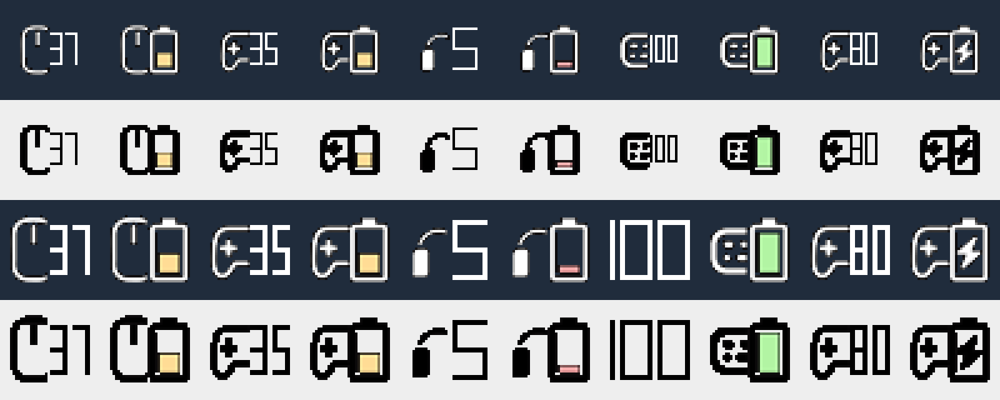

# BatteryDeck

A tiny Windows tray app that shows the battery level of your wireless devices: mice, keyboards, headsets and game controllers, from several vendors, in one place.



- **One ~0.7 MB exe.** No installer and no runtime: no .NET, no VC++ redistributable.
- **About 3 MB of memory and no measurable idle CPU.** It does a few milliseconds of work every few minutes and sleeps the rest of the time.
- **One tray icon per device you choose.** Left-click any icon to switch between a battery picture and the percentage (shown next to a small device picture).
- **Only connected devices are shown.** A switched-off controller or earbuds in their case disappear, and come back when they reconnect.
- **Supported device families:** Logitech (HID++), GameSir Cyclone 2, and any Bluetooth device whose battery level Windows already tracks.

BatteryDeck started as a native C++ port of [LGSTrayBattery](https://github.com/andyvorld/LGSTrayBattery) and grew into a small multi-vendor "provider" architecture.

---

## Contents

1. [Download and install](#download-and-install)
2. [Supported devices](#supported-devices)
3. [Using it](#using-it)
4. [Settings](#settings)
5. [Building from source](#building-from-source)
6. [Architecture](#architecture)
7. [Device protocols](#device-protocols)
8. [Power and performance design](#power-and-performance-design)
9. [Adding a new device family](#adding-a-new-device-family)
10. [Troubleshooting](#troubleshooting)
11. [Known limitations](#known-limitations)
12. [Coming from LGSTray](#coming-from-lgstray)
13. [Credits and license](#credits-and-license)

---

## Download and install

1. Download `BatteryDeck-v1.0.0-win-x64.zip` from the [Releases](../../releases) page.
2. Unzip it into a folder of your choice, for example `C:\Applications\BatteryDeck`.
3. Run `BatteryDeck.exe`.

**Requirements:** Windows 10 1809 or newer (Windows 11 recommended), 64-bit.

> Windows 11 puts new tray icons in the hidden **^** area. Drag BatteryDeck's icons onto the taskbar to keep them visible. Windows remembers them by the exe's path, so keep the exe in the same place when updating.

---

## Supported devices

| Family | Devices | Connection | Charging state |
|---|---|---|---|
| **Logitech** | Mice, keyboards and headsets using HID++ 2.0: Lightspeed, Unifying and Bolt receivers, and wired HID++ | USB receiver or cable | Yes |
| **GameSir** | Cyclone 2 | 2.4 GHz dongle or USB cable | Yes |
| **Bluetooth** | Anything Windows shows a battery for in *Settings → Bluetooth & devices*: Xbox controllers over Bluetooth, earbuds, headsets, mice, keyboards | Bluetooth LE and classic | No (Windows only exposes the level) |

**Tested with:**
- Logitech PRO X2 SUPERSTRIKE on a Lightspeed receiver
- GameSir Cyclone 2 on its dongle
- Xbox Wireless Controller over Bluetooth LE
- Sony WF-1000XM4 over classic Bluetooth

Other devices in these families use the same code paths but haven't been tried. Reports are welcome.

---

## Using it

| Action | Result |
|---|---|
| **Left-click** an icon | Switch all icons between the battery picture and the number (the choice is saved) |
| **Right-click** an icon | Open the menu |
| Hover | Tooltip, e.g. `GameSir Cyclone 2: 35%` or `PRO X2 SUPERSTRIKE: 37%, charging` |

**Menu:**

| Item | What it does |
|---|---|
| **Devices ▸** | Every connected device with its current %. Tick a device to give it a tray icon. Ticks are remembered, so the icon returns when the device reconnects. |
| **Rediscover Devices** | Drops every connection and scans again. Rarely needed: plugging and unplugging is detected automatically. |
| **Display Numeric Icon** | Same as left-click. |
| **Autostart with Windows** | Adds or removes BatteryDeck from `HKCU\Software\Microsoft\Windows\CurrentVersion\Run`. |
| **Exit** | Closes BatteryDeck. |

**What the icons show:**

- **Battery-picture mode:** the device type, plus a battery with a level bar: red under 10%, then 30%, 50% and 100% steps. A lightning bolt means charging, and "?" means no reading yet.
- **Numeric mode:** the same device picture, with the percentage drawn as crisp pixel digits in place of the battery. "100" uses the whole icon at small sizes.
- **No device showing:** while no ticked device is connected, a single "?" icon keeps the menu reachable.

---

## Settings

### `appsettings.toml` (next to the exe)

Read at startup, so restart BatteryDeck after editing. Times are in seconds.

```toml
[Logitech]
enabled = true
retryTime = 10          # retry after a failed read
pollPeriod = 600        # time between reads after a successful one
disabledDevices = [     # ignore devices whose name contains any of these
]

[GameSir]
enabled = true
retryTime = 30
pollPeriod = 600

[Bluetooth]
enabled = true
pollPeriod = 120        # only reads values Windows already keeps, so this is cheap
```

If the file is missing, the defaults above are used. `[Native]` (LGSTray's name for the Logitech section) is still accepted.

### Per-user choices (registry)

`HKCU\Software\BatteryDeck`:

| Value | Type | Meaning |
|---|---|---|
| `SelectedDevices` | REG_MULTI_SZ | IDs of ticked devices |
| `NumericDisplay` | REG_DWORD | 1 = numeric icons |
| `DeviceNames\<id>` | REG_SZ | Last known device names |

### Device IDs

Each ID starts with its provider, so IDs never collide across vendors:

| Prefix | Built from | Example |
|---|---|---|
| `logi:` | HID++ serial number (feature 0x0003), or unit ID + model ID | `logi:1A2B3C4D5E6F7A8B9C0D1E` |
| `gamesir:` | Model + USB serial number | `gamesir:c2-0000ABCDEF123456` |
| `bt:` | Windows device container GUID | `bt:01234567-89ab-cdef-0123-456789abcdef` |

---

## Building from source

### With LLVM-MinGW (clang)

```bash
winget install MartinStorsjo.LLVM-MinGW.UCRT
```

```bash
build-mingw.bat
```

### With Visual Studio / Build Tools

Install the **"Desktop development with C++"** workload, then:

```bash
build.bat
```

Both scripts produce `build\BatteryDeck.exe`: statically linked, about 0.7 MB, and depending only on DLLs that ship with Windows. Place `appsettings.toml` next to it (optional).

### Source layout

```
├── build-mingw.bat        build with LLVM-MinGW (clang)
├── build.bat              build with MSVC
├── appsettings.toml       default settings
├── docs\icons.png         icon preview
├── res\                   icon PNGs, app icon, manifest, resource script
└── src\
    ├── main.cpp           tray window, icons, menu, plug/unplug, sleep/resume
    ├── common.h           DeviceState, DeviceKind, shared helpers
    ├── provider.h         Provider interface + PeriodicWorker helper
    ├── hid_win.*          Windows HID enumeration and timed writes
    ├── settings.*         appsettings.toml, registry, migration, autostart
    ├── icons.*            GDI+ icon drawing (battery picture / pixel digits)
    ├── resource.h         resource IDs
    └── providers\
        ├── logitech.*     HID++ receivers and devices
        ├── gamesir.*      GameSir Cyclone 2
        └── bluetooth.*    Windows' Bluetooth battery values
```

**Build notes:**
- **Libraries:** `user32 shell32 gdi32 gdiplus advapi32 setupapi hid ole32 shlwapi uuid cfgmgr32`.
- **MinGW headers:** they lack DevQuery, so `bluetooth.cpp` declares the few structs it needs and loads `DevGetObjects` from `cfgmgr32.dll` at runtime.

---

## Architecture

```
            ┌───────────────────────── UI thread (main.cpp) ───────────────────────────┐
            │  hidden window ── WM_DEVICECHANGE (HID plugged/unplugged, debounced 1.5 s)│
            │                ── WM_POWERBROADCAST (resume → rescan + poll soon)         │
            │                ── WM_SETTINGCHANGE (light/dark taskbar) ── TaskbarCreated │
            │  tray icons + menu  ◄── WM_APP_DEVICES_CHANGED ◄──┐                       │
            └──────────────┬────────────────────────────────────┼───────────────────────┘
                 Rescan / Stop / PollSoon                 PublishDevice(DeviceState)
                           ▼                                    │   (thread-safe map)
   ┌──────────────────┬─────────────────────┬──────────────────┴───┐
   │ LogitechProvider │ GameSirProvider     │ BluetoothProvider    │
   │ per receiver:    │ 1 PeriodicWorker    │ 1 PeriodicWorker     │
   │  reader thread   │ heartbeat → read    │ CM property reads +  │
   │  worker thread   │ one report → close  │ DevQuery "connected" │
   └──────────────────┴─────────────────────┴──────────────────────┘
```

- **`DeviceState`** is all the UI knows about a device: `id`, `name`, `kind` (Mouse / Keyboard / Headset / Gamepad / Other), `hasBattery`, `connected`, `percent` and `status` (discharging / charging / full / …).
- **`Provider`** is the interface each vendor or transport implements:
  ```cpp
  class Provider {
      virtual const wchar_t* Name() const = 0;
      virtual void Rescan() = 0;    // startup + every plug/unplug (UI thread)
      virtual void Stop() = 0;      // exit / "Rediscover Devices"
      virtual void PollSoon() {}    // after resume from sleep
  };
  ```
  Providers run their own background threads and report with `PublishDevice()`, which stores the state and wakes the UI.
- **`PeriodicWorker`** is a thread that runs a job, sleeps on a condition variable until the job's requested next time, and can be woken early.
- **UI:**
  - One tray icon per device that is both ticked and connected.
  - An icon is redrawn only when what it shows changes.
  - Each icon's ID is the device's position in the ticked list, so pinned taskbar positions survive restarts. When positions shift, the affected icons are removed before any are re-added, so IDs never collide.
  - Icons are re-added after Explorer restarts.
- **Icons:**
  - Embedded PNGs are decoded once and composited at the taskbar's exact icon size for its DPI.
  - Numeric digits are seven-segment shapes built from solid, pixel-aligned rectangles with smoothing off: 1-px bars below 28 px, 2-px bars from 28 px, with height tied to width so digits keep their shape. Font outlines turned into grey blur at 16 px.

**Threads:** 1 UI, 2 per Logitech receiver, 1 GameSir and 1 Bluetooth, plus system threads. All of them block in the kernel while idle: there are no polling loops and no timers firing in between.

---

## Device protocols

### Logitech (HID++ 2.0), `src/providers/logitech.cpp`

**Discovery:** VID `046D` HID collections on a vendor usage page (`0xFF00`–`0xFFFF`), with usage 1 (short, 7-byte reports) or 2 (long, 20-byte reports). The two collections of one receiver are paired by Windows container ID.

**Receiver setup:**
1. Read register `0x02` (`10 FF 81 02 00 00 00`) to learn how many devices are paired.
2. Send "force arrival" (`10 FF 80 02 02 00 00`). Each connected device then announces itself with notification `0x41`.
3. If nothing announces within 500 ms, ping slots 1–6 and `0xFF` directly.

**Device setup** happens on every `0x41` "link established" notification, including each wake from sleep:
1. 3 successful pings in a row.
2. IFeatureSet (`0x0001`): read the feature count and enumerate the feature table.
3. `0x0005` name and type, then `0x0003` serial number (the stable ID).
4. Pick the battery feature in this order: `0x1000` (level), `0x1001` (voltage, mapped to % with a lookup table), `0x1004` (unified battery).

**Polling:** one schedule entry per device: read, then wait `pollPeriod` (`retryTime` after a failure). A reconnect replaces the schedule instead of stacking a second loop.

**Transport:** a reader thread waits on overlapped reads of both collections. A worker thread sends one request at a time and waits up to 100 ms for the matching reply (same device index, feature index and software ID `0x0A`). HID++ 1.0 (`0x8F`) and 2.0 (`0xFF`) error replies end the wait early.

### GameSir Cyclone 2, `src/providers/gamesir.cpp`

Worked out for interoperability by reading how GameSir Connect talks to the controller, and confirmed on real hardware.

**Discovery:** VID `3537`, vendor collection on usage page `0xFFF0` (64-byte reports).

| PID | Mode |
|---|---|
| `0x100B` | Wireless, on the dongle, controller on |
| `0x102A` | Wireless |
| `0x101D` | Wired |
| `0x1053` | Wired (ADC variant) |
| `0x0575` | Dongle with the controller **off**: not polled, shown as disconnected |

The dongle switches between `0x0575` and `0x100B` when the controller sleeps or wakes. Windows reports that as an unplug and plug, so BatteryDeck picks it up within about 1.5 s.

**Battery read:**
1. Write the heartbeat output report: `0F F2 00` padded with zeros to 64 bytes. GameSir Connect sends the same thing continuously; it changes no settings.
2. The controller streams input report `0x12` at about 130 Hz for about 2 s, then stops on its own.
3. From the first valid report (sticks centred at `0x80`, not all zeros): **byte 35 = charge state** (0 = discharging, 2 = full, other = charging), **byte 36 = battery %**.
4. Close the handle. A read takes about 20 ms.

Example report at 35%, not charging (byte 35 = `00`, byte 36 = `23`):
```
12 80 80 80 80 0F 00 00 00 00 BA B5 00 EA FF FF FF 05 00 3F 01 9F 1F 0D 00 00 00 00
00 00 00 00 00 00 00 00 23 00 00 33 05 ...
```

Other GameSir models use different protocols and aren't supported yet. Windows' XInput sees the Cyclone 2, but reports it as "wired, full", so it can't be used for the battery.

### Bluetooth, `src/providers/bluetooth.cpp`

BatteryDeck never talks to Bluetooth devices itself; it reads what Windows already knows:

| What | Where |
|---|---|
| Battery % | Device property `{104EA319-6EE2-4701-BD47-8DDBF425BBE5}, 2` (BYTE), on the `BTHLE\DEV_…` node (BLE) or a profile node such as Hands-Free (classic). All `BTHLE` / `BTHENUM` nodes are checked and grouped by container. |
| Name | `DEVPKEY_Device_FriendlyName` on the `…\DEV_<address>` node |
| Connected | Container property *System.Devices.Connected* `{78C34FC8-104A-4ACA-9EA4-524D52996E57}, 55`, read with `DevGetObjects` |
| Type | Container category (`{78C34FC8-…}, 90`, e.g. `Input.Gaming.Gamepad`), falling back to name keywords |

Windows keeps the last value after a device disconnects, so the "connected" flag is what decides whether a device is shown.

---

## Power and performance design

| Choice | Why |
|---|---|
| Native C++, static runtime, single process | About 3 MB of memory instead of the 40–60 MB of the .NET/WPF original |
| Blocking overlapped reads, condition-variable waits | No thread wakes unless a report arrives or a poll is due |
| GameSir: open, heartbeat, read 1 report, close | Leaving the stream open would mean about 130 wakeups per second |
| Bluetooth: read existing Windows properties | Costs nothing on the device or the radio |
| `WM_DEVICECHANGE`, debounced 1.5 s | No periodic USB scanning |
| One poll schedule per device | Reconnects can't stack extra polling loops |
| Below-normal priority + EcoQoS + ignore-timer-resolution | Windows can run the few milliseconds of work on efficient cores |
| Icons redrawn only on visible change; GDI handles freed | No slow handle or memory growth |

**Measured** with all three providers enabled: 0.000 s CPU over 30 s idle, about 2.8 MB private memory, 8 threads.

| | Disk | Memory | Idle CPU | Processes |
|---|---|---|---|---|
| LGSTray 3.0.3 (.NET, standalone) | 237 MB | ~63 MB | ~0.6% of a core | 2 |
| **BatteryDeck 1.0.0** | 0.7 MB | ~3 MB | 0.000 s / 30 s | 1 |

---

## Adding a new device family

1. **Find out how the device reports its battery.**
   - If Windows already shows its battery in *Bluetooth & devices*, it already works.
   - For a USB/2.4 GHz dongle: list its HID collections (VID, PID, usage page, report sizes) and capture input reports with a read-only probe.
   - Many vendor apps are Electron apps whose `resources\app.asar` contains the protocol in readable JavaScript.
   - Confirm on real hardware with the most harmless command available (a heartbeat or read request) before sending anything else.
2. **Create `src/providers/<vendor>.h/.cpp`** deriving from `Provider`:
   - `Rescan()`: `EnumerateHidInterfaces(vid)`, store the targets, and start or wake a `PeriodicWorker`.
   - Worker: read each device, fill a `DeviceState` (ID prefix `<vendor>:`), and call `PublishDevice()` only when something changed. Return the delay until the next run.
   - Mark vanished devices `connected = false` instead of dropping them.
   - `Stop()`: set a stop event and stop the worker.
3. **Register it** in `wWinMain` behind a settings switch, and add its section to `Settings`, `LoadToml()` and `appsettings.toml`.
4. **Add the `.cpp`** to both build scripts.
5. **New device type?** Add a `DeviceKind` and two 512×512 PNGs (black and white variants, art in the left half like the others).

---

## Troubleshooting

Run with logging:

```bash
BatteryDeck.exe --debug
```

It writes `BatteryDeck.log` next to the exe: providers, receivers, devices (with IDs), every reading and every failure.

| Symptom | What to check |
|---|---|
| Icon not visible | Windows 11 put it in the **^** overflow. Drag it to the taskbar, or enable it in *Settings → Personalization → Taskbar → Other system tray icons*. |
| Device missing | Only connected devices are shown. Is it on? Is its provider enabled in `appsettings.toml`? For Bluetooth: does Windows show a battery for it? |
| Shows "?" | No successful read yet. It updates when the device wakes or reconnects. |
| Two copies running | Not possible: the single-instance mutex `Local\BatteryDeck` prevents it. Don't run LGSTray at the same time, though: both would talk to the Logitech receiver. |

---

## Known limitations

- **Logitech:** only tested with one Lightspeed mouse. Devices without the name feature (`0x0005`) are ignored, as in the original.
- **GameSir:** Cyclone 2 only. The "charging" value is inferred from GameSir's code and hasn't been observed live yet.
- **Bluetooth:** no charging state. The level is only as fresh as Windows' copy. Devices Windows has no battery value for aren't listed.
- **Sleep and resume:** handled (a rescan plus an early poll 5 s after resume), but not tested across a full overnight sleep.

---

## Coming from LGSTray

BatteryDeck takes over LGSTray's settings automatically on first run:

1. Copies `HKCU\Software\LGSTray` to `HKCU\Software\BatteryDeck`. If neither exists, it imports the .NET LGSTray's `user.config` (selected devices + numeric display).
2. Adds the `logi:` prefix to saved Logitech IDs.
3. Replaces an `LGSTrayGUI` autostart entry with `BatteryDeck`.
4. Keeps accepting the old `[Native]` section in `appsettings.toml`.

---

## Credits and license

- Logitech HID++ handling ported from **[LGSTrayBattery](https://github.com/andyvorld/LGSTrayBattery)** by andyvorld (GPL-3.0). Battery icons also come from that project.
- Controller icon drawn for BatteryDeck in the same style.
- GameSir protocol notes come from studying GameSir Connect for interoperability. No GameSir code or binaries are included.

BatteryDeck is licensed under the **GNU General Public License v3.0**; see [LICENSE](LICENSE).
